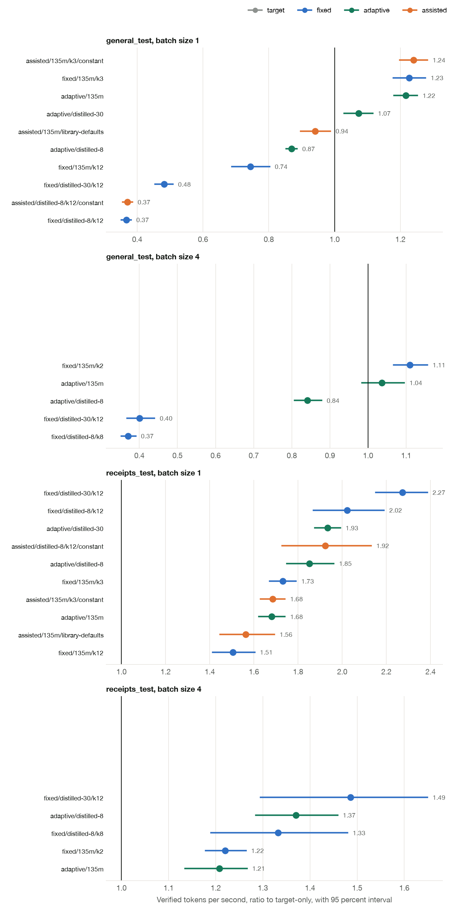

# Benchmark report

Every number comes from `runs/final/v2`. Commit `0070a9a` produced the run, and the manifest
records its hashes, hardware and command. `runs/final/v2/report/tables.md` has every table.
Rebuild it with `make site`.

## Setup

- **Target:** SmolLM2 1.7B, float32 on Metal, temperature 0.7, 128 token limit.
- **Drafts:** stock SmolLM2 135M, and two distilled drafts of it, 8 and 30 layers.
- **Workloads:** 24 receipts from three unseen template families, and 30 general prompts.
- **Replication:** 3 repeats with independent seeds. One unit is one prompt at batch size 1
  and one static batch at batch size 4. Intervals are 95 percent two-level bootstrap intervals
  over units and repeats.

## Primary decision

| Arm | Baseline | Ratio | Interval | Rule | Result |
|---|---|---|---|---|---|
| `adaptive/distilled-8` | `fixed/distilled-8/k12` | 0.915 | 0.866 to 0.968 | Lower bound above 1.00 | Not supported |

The interval sits entirely below 1.00, so the fixed length was faster here, not just tied.

## Speed against the large model alone

Batch size 1, ratio of verified tokens per second.

| Arm | Receipts | General text |
|---|---|---|
| `fixed/distilled-30/k12` | 2.27 (2.15 to 2.39) | 0.48 (0.46 to 0.51) |
| `fixed/distilled-8/k12` | 2.02 (1.87 to 2.19) | 0.37 (0.35 to 0.38) |
| `adaptive/distilled-30` | 1.93 (1.88 to 1.99) | 1.07 (1.03 to 1.12) |
| `adaptive/distilled-8` | 1.85 (1.75 to 1.96) | 0.87 (0.85 to 0.89) |
| `fixed/135m/k3` | 1.73 (1.67 to 1.79) | 1.23 (1.18 to 1.28) |
| `adaptive/135m` | 1.68 (1.62 to 1.74) | 1.22 (1.18 to 1.25) |
| `fixed/135m/k12` | 1.51 (1.41 to 1.60) | 0.74 (0.69 to 0.80) |

## What the evidence shows

**A tuned fixed length beats the controller on its own workload.** Acceptance on receipts is
steady enough that a long fixed block pays. The controller spends some drafts learning what
the fixed length already knows, and its estimate is cautious after each rejection.

**The controller limits the damage from wrong tuning.** With the 8-layer draft on general
text, a fixed length of 12 ran at 0.37x. The controller shortened its drafts and held 0.87x,
a gain of 2.37x (2.28 to 2.46). The 30-layer draft shows the same effect: 2.23x (2.09 to 2.39).

**It does not replace a sensible short length.** With the stock draft, `fixed/135m/k3` and
`adaptive/135m` were close on both workloads: 0.97 on receipts (0.95 to 1.00) and 0.99 on general
text (0.97 to 1.02). A controller earns its place only when the tuned length is far from
right, so the honest claim is insurance, not speed.

**Distillation is the larger gain.** At the same size and draft cost, the 30-layer distilled
draft beat the stock draft's best fixed length by 1.31x (1.25 to 1.37). This was computed after
the run and was not in the frozen plan. The cost is that the same draft lost to the stock
draft on general text.

**A shallow draft overfits templates.** The 8-layer draft reached 2.4x on validation receipts
and 2.02x on the test families. It costs less per pass than the 30-layer draft, but it
generalized worse, and the 30-layer draft won on the test split.

**The engine matches a mature implementation.** At the same draft and length, it ran at 1.03x
(1.00 to 1.05) of assisted generation in Transformers on receipts, and 0.99x (0.96 to 1.02) on
general text. The library's heuristic schedule was slower than a constant length on both.

## Where speculation gets slower

| Condition | Ratio to the large model alone |
|---|---|
| Distilled draft at fixed length, general text, batch size 1 | 0.37 to 0.48 |
| Stock draft at length 12, general text, batch size 1 | 0.74 |
| Adaptive with the 8-layer draft, general text, batch size 1 | 0.87 |
| Distilled draft at fixed length, general text, batch size 4 | 0.37 to 0.40 |
| Adaptive with the 8-layer draft, general text, batch size 4 | 0.84 |

The stock draft stayed above 1.00 at batch size 1 at length 3. At batch size 4 on general text,
`fixed/135m/k2` reached 1.11 and `adaptive/135m` 1.04 (0.98 to 1.10).

## Concurrency

Static batching shares one draft length across the batch, so one hard sequence shortens or
wastes work for all four. The best batch size 4 ratio on receipts was 1.49 (1.30 to 1.65),
against 2.27 at batch size 1. The large model alone also gains the most from batching, which
narrows what speculation can add.

## Latency and memory

| Receipts, batch size 1 | Median TTFT | Median gap | p95 gap | Tokens per pass |
|---|---|---|---|---|
| Large model alone | 0.168 s | 34.4 ms | 43.0 ms | 1.00 |
| `fixed/distilled-30/k12` | 0.277 s | 0.0 ms | 149.0 ms | 9.43 |
| `adaptive/distilled-30` | 0.207 s | 0.0 ms | 115.6 ms | 5.63 |

A median gap of zero means most tokens arrive in a group with the token before them. Requests
finish sooner, but the stream is burstier and the first token comes later.

GPU memory was 7.6 GB for the large model alone and at most 7.9 GB with a draft at batch size
1, and up to 9.3 GB at batch size 4. Process peak RSS read 10.7 GB in every arm, because the
peak happens while loading weights, so it does not separate the arms.

## Correctness

- **Exact law on tiny models.** `specdec/exhaustive.py` walks every random path through the
  real engine and compares the result with the target's probabilities.
- **Exact law on real weights.** 1,500 draws per arm over 3 new tokens, 135M draft: p of 0.150
  and 0.084 at a fixed length, 0.608 and 0.594 adaptive. The draft-only negative control scored
  p = 0.0 on both prompts, and a repeat of the target scored 0.109 and 0.414.
- **Batch equals single.** At equal seeds, batch size 1 and batch size 4 gave identical tokens on
  120 of 120 receipts compared.
- **Precision.** float16 changes the target's distribution with the block size, so the benchmark
  uses float32. See decision 2.

## Task accuracy

Receipt field accuracy was 0.637 for the large model alone, and 0.611 to 0.661 across arms at
batch size 1. All arms share one output law, so these differences are sampling noise. This score
measures the model, not the sampler.

## Failures that changed the work

See `DECISIONS.md`. The main ones are a discarded final run caused by a seed bug, float16
failing the law check, and a training run that exhausted memory.
